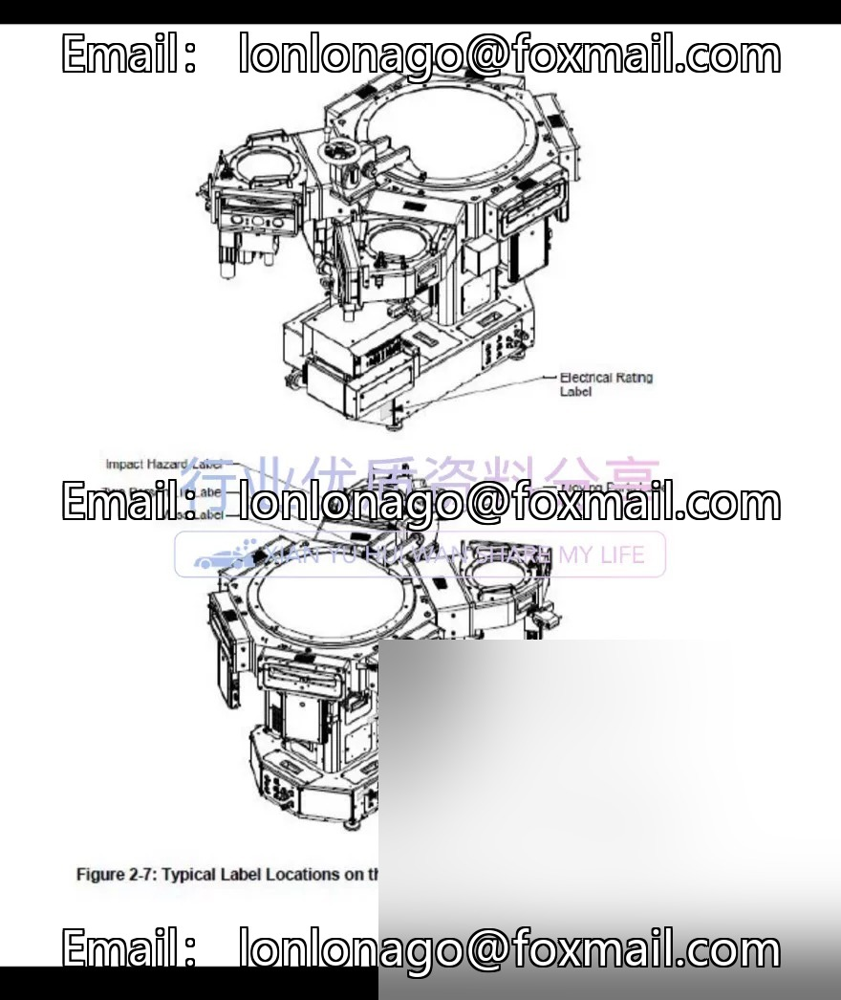
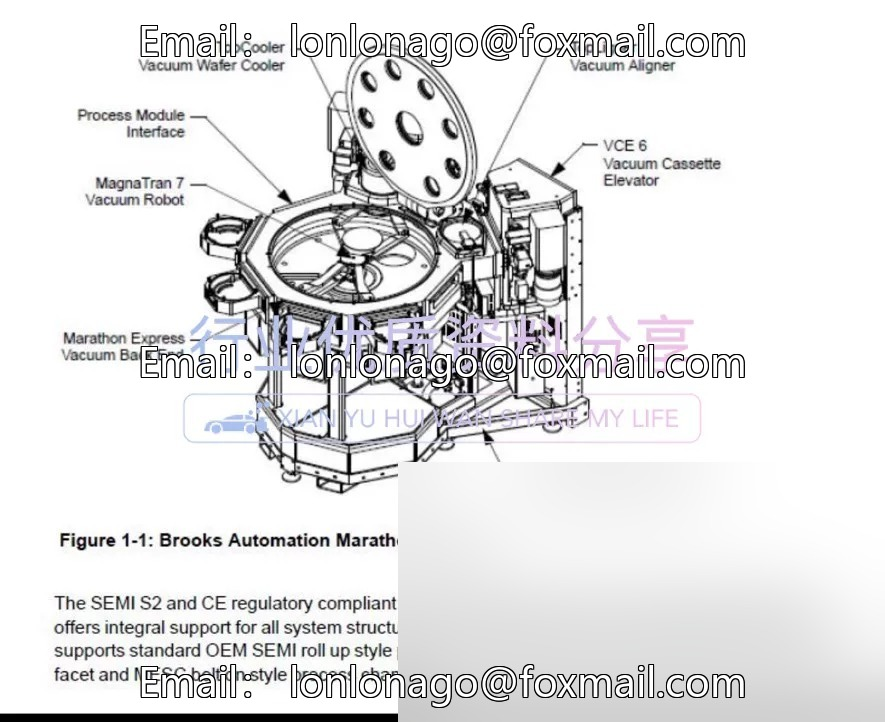
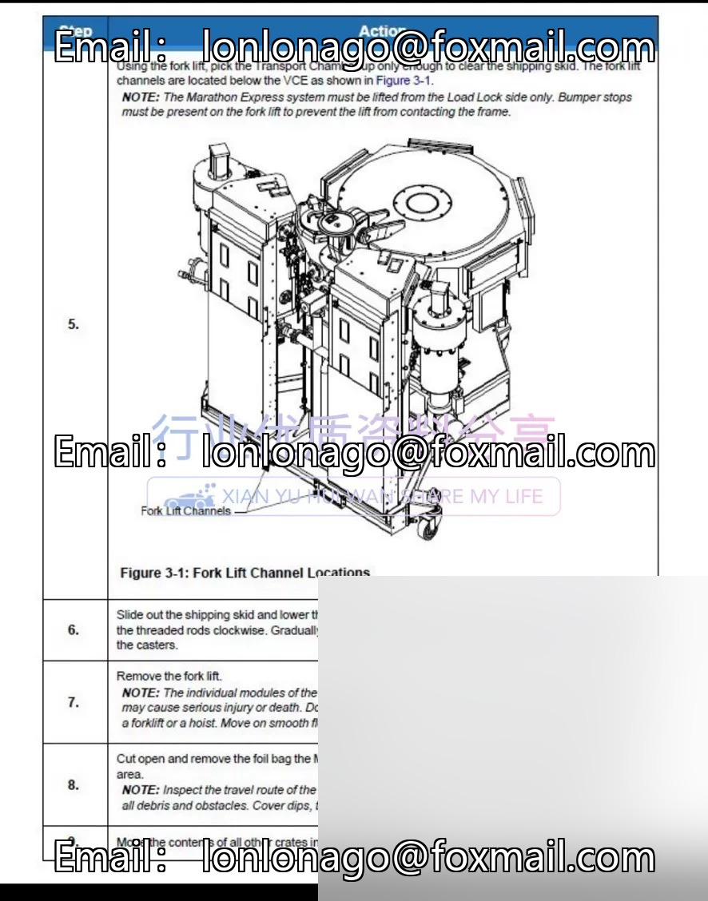
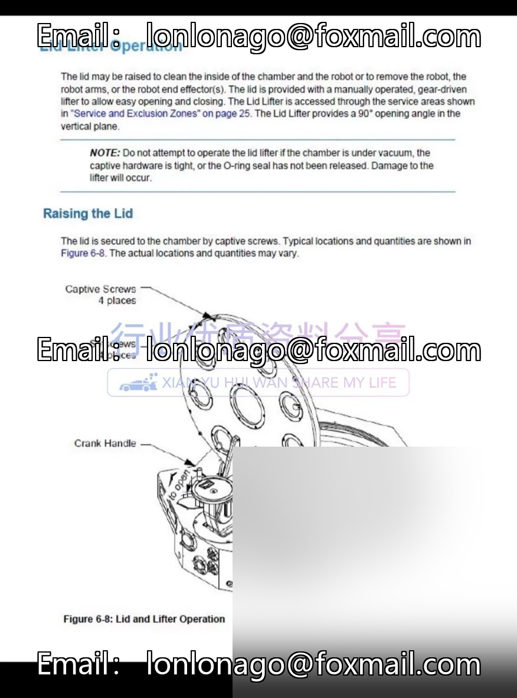
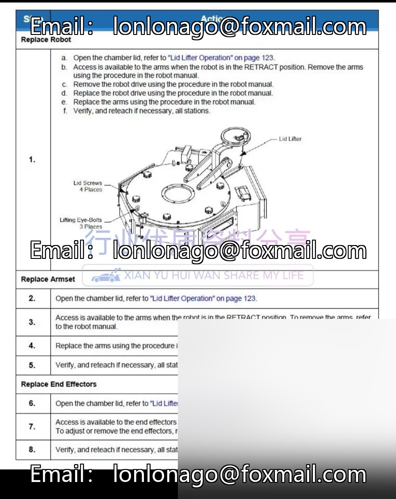
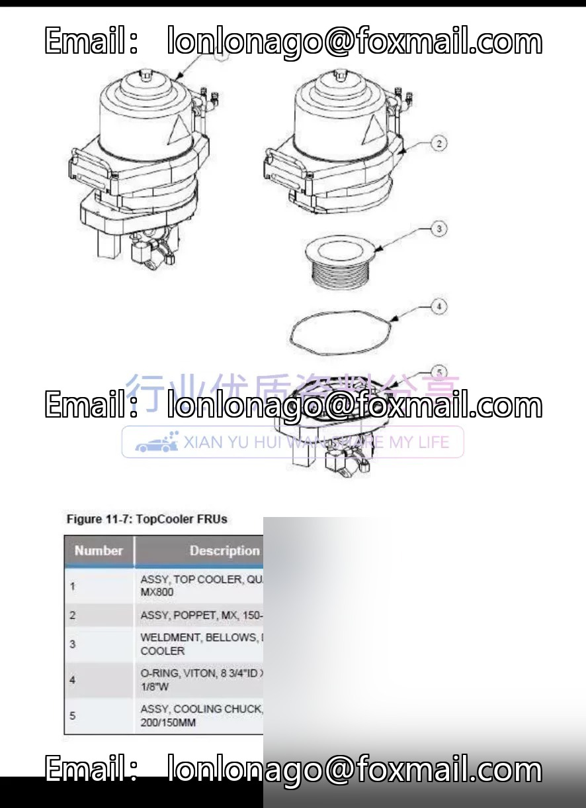
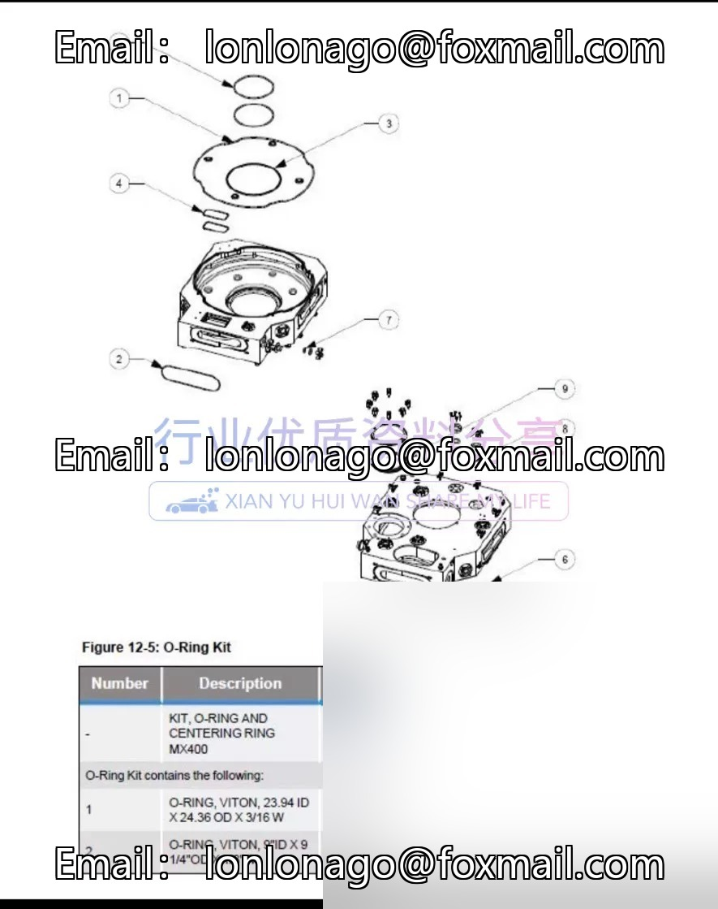
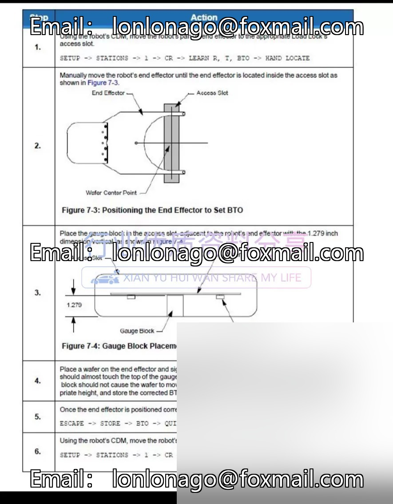

# BROOKS MARATHON series wafer transport integration platform

## Body

BROOKS MARATHON series user manual collection for the Brukers wafer transfer integration platform, including four model types: Express, 400, M2, and Micro. The manual contains introductions of cavity and wafer hand structures, with high reference value of 800 pages.

Capture and send the electronic original directly! The following images include screenshots of the file portion. Please confirm before placing the order! Due to the replicable nature of electronic documentation Therefore, are allowed after purchase! Thanks for understanding!

For personal learning and reference use only.

The platform provides the BROOKS MARATHON series user manual collection, including Express, 400, M2 and Micro models; the manual covers cavity and wafer hand structure introductions, with 800 pages of reference value and electronic original files plus partial file screenshots.

<!-- AI_ENRICHED -->

## Images

## Payment

Here is a pay link on Stripe ( https://buy.stripe.com/3cs8yP7sY87d0vu9AB ). Please contact me lonlonago@foxmail.com after funding $89, and I will send you a complete data files , thank you!

